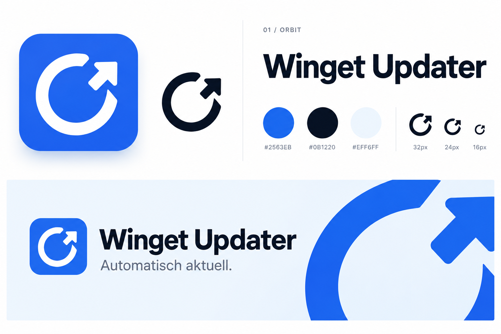
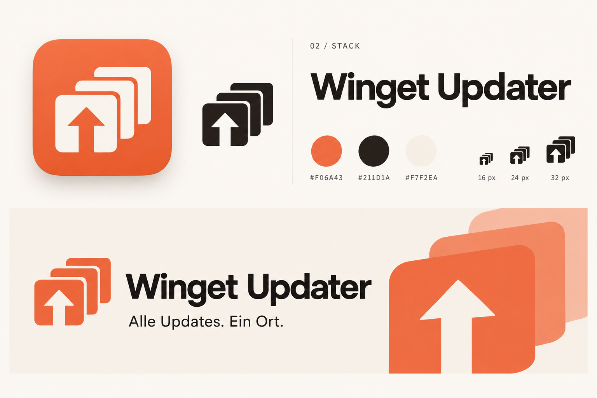
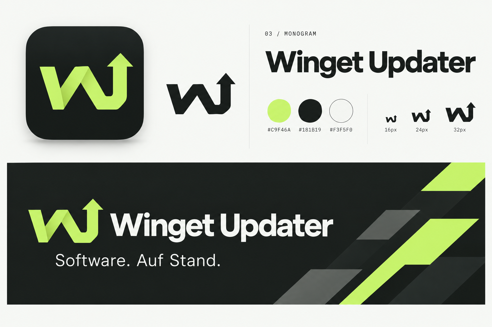
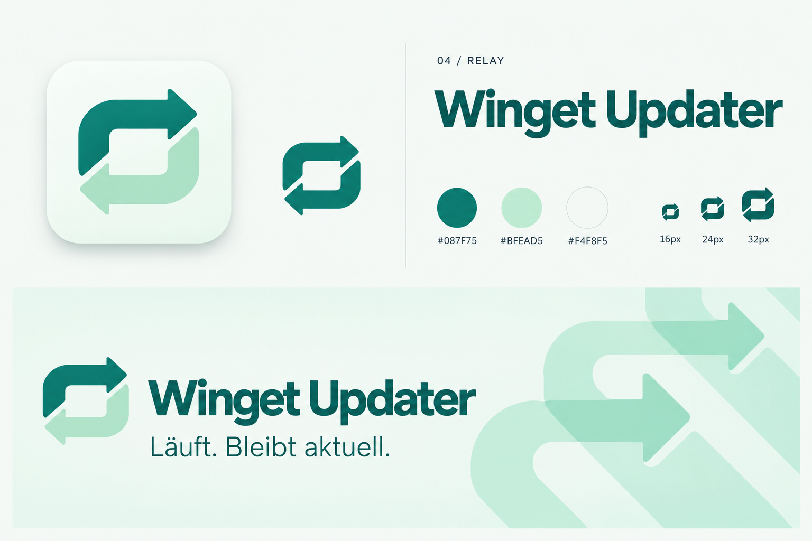
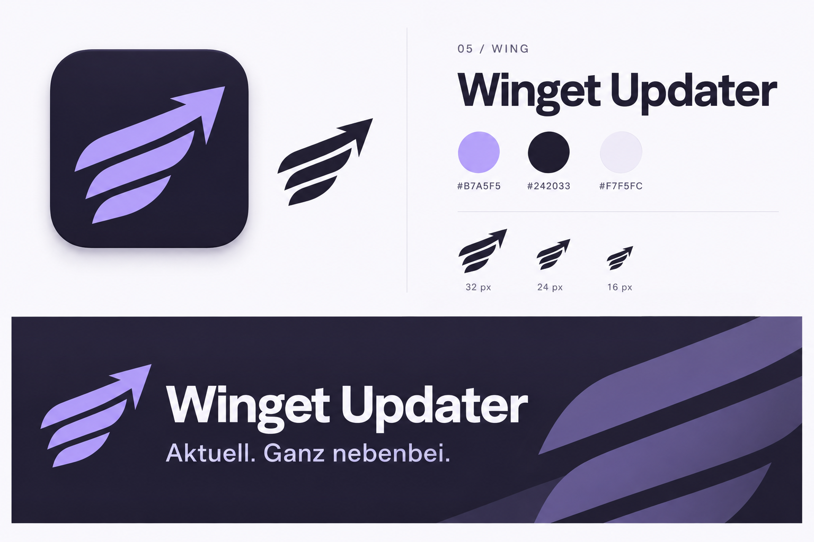

# Winget Updater – fünf Branding-Ideen

**Gewählte Richtung: 03 · Monogram.** Die fertigen Assets, Tokens und Exporthinweise stehen in [IDENTITY.md](IDENTITY.md).

Erstellt am 30. Oktober 2026. Jede Konzepttafel zeigt ein App-Icon, eine monochrome Zeichenvariante, eine Farbpalette und einen README-Banner-Entwurf.

## Ausgangspunkt

Eine ruhige Windows-App, die Software über mehrere Paketmanager aktuell hält. Das Branding soll Zuverlässigkeit, Übersicht und wenig Aufwand vermitteln. Der Produktname bleibt **Winget Updater**; Orbit, Stack, Monogram, Relay und Wing sind Namen der Gestaltungsrichtungen.

Die Wortmarken orientieren sich an der bereits im Projekt verwendeten Geist. Für Nebeninformationen passt Geist Mono.

## Vergleich

| Nr. | Richtung | Zeichenidee | Wirkung | Akzent / Dunkel / Hell |
| --- | --- | --- | --- | --- |
| 01 | [Orbit](01-orbit.png) | Offener Update-Kreis mit Pfeil | Klar, vertraut, funktional | `#2563EB` / `#0B1220` / `#EFF6FF` |
| 02 | [Stack](02-stack.png) | Drei Paketebenen mit ausgespartem Aufwärtspfeil | Warm, übersichtlich, zugänglich | `#F06A43` / `#211D1A` / `#F7F2EA` |
| 03 | [Monogram](03-monogram.png) | Verdichtetes WU-Zeichen mit Pfeilabschluss | Prägnant, technisch, kontrastreich | `#C9F46A` / `#181B19` / `#F3F5F0` |
| 04 | [Relay](04-relay.png) | Zwei ineinandergreifende Übergabepfeile | Ruhig, freundlich, kontinuierlich | `#087F75` / `#BFEAD5` / `#F4F8F5` |
| 05 | [Wing](05-wing.png) | Abstrakter Flügel mit Vorwärtspfeil | Leicht, dynamisch, einprägsam | `#B7A5F5` / `#242033` / `#F7F5FC` |

**Empfehlung:** 03 für ein kompaktes, eigenständiges App-Zeichen; 05 für den stärksten Bezug zum Namen. 01 erklärt die Update-Funktion am unmittelbarsten.

## 01 · Orbit

**„Automatisch aktuell.“**

Der Kreis steht für wiederkehrende Updates, der Pfeil für Fortschritt. Das Blau lässt sich gut als sparsamer Akzent in die vorhandene neutrale Oberfläche übernehmen. Der große angeschnittene Kreis bildet ein einfaches Motiv für Banner und Release-Grafiken. Die Symbolsprache ist vertraut, dadurch weniger eigenständig als 03 oder 05.

## 02 · Stack

**„Alle Updates. Ein Ort.“**

Die gestapelten Flächen stehen für mehrere Programme und Paketmanager. Ein ausgesparter Aufwärtspfeil verbindet sie mit der Update-Funktion. Vermilion und warmes Elfenbein geben dem Werkzeug einen zugänglichen Charakter. Für das endgültige kleine Tray-Zeichen sollten die Abstände zwischen den Ebenen gezielt ausgearbeitet werden.

## 03 · Monogram

**„Software. Auf Stand.“**

Ein kompaktes Monogramm verbindet den Namen mit einem Aufwärtspfeil. Graphit und Limette erzeugen eine markante Silhouette; die diagonalen Elemente funktionieren auch als wiederkehrendes Bannermotiv. In der Ausarbeitung sollte die Lesbarkeit des U im gemeinsamen Zeichen weiter geschärft werden.

## 04 · Relay

**„Läuft. Bleibt aktuell.“**

Zwei Pfeile bilden einen ruhigen Kreislauf: prüfen, übergeben, aktualisieren. Petrol und Mint betonen den unaufgeregten Betrieb im Hintergrund. Für monochrome Anwendungen bleibt dieselbe Form erhalten; die beiden Pfeilflächen werden dann in einer Farbe dargestellt.

## 05 · Wing

**„Aktuell. Ganz nebenbei.“**

Der abstrakte Flügel greift den Klang des Namens auf. Seine ansteigende Kontur bringt Bewegung in das Zeichen, ohne ein detailliertes Maskottchen zu benötigen. Lavendel und dunkles Aubergine bilden eine eigenständige Farbwelt. Die Zwischenräume der Flügelflächen brauchen bei der späteren Pixeloptimierung besondere Aufmerksamkeit.

## Dateien und Ausarbeitung

Die fünf PNG-Dateien sind Konzepttafeln im Format 1536 × 1024 Pixel, erstellt mit der integrierten Bildgenerierung. Die vollständige gemeinsame Vorgabe und die fünf individuellen Prompts stehen in [PROMPTS.md](PROMPTS.md).

Die dargestellten kleinen Icons sind schematische Vorschauen. Die Tafeln dienen der Auswahl einer Richtung; separate SVG-, PNG- und ICO-Dateien sowie ein eigenständiger README-Banner wären der nächste Ausarbeitungsschritt. Dabei werden Geometrie, echte 16-/20-/24-/32-Pixel-Darstellung und helle/dunkle Tray-Varianten geprüft.

